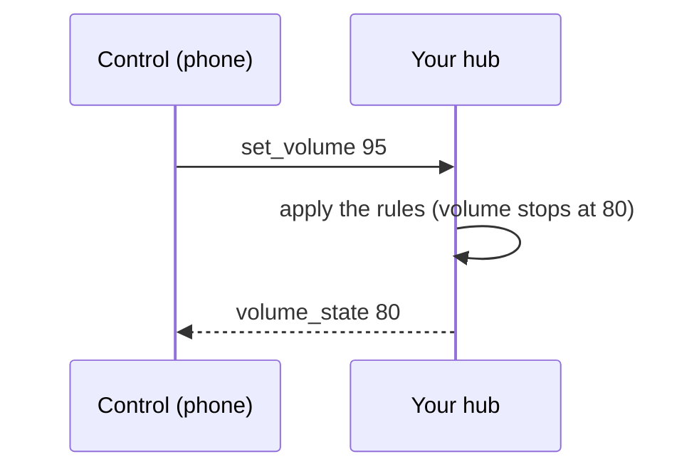

# Your first hub

In the **first-layout** tutorial a dial and a slider shared a value on your phone. Here a small program, the **hub**,
owns the value instead, and the controls only ask. That one change is how every real device works: the phone is
never the authority, so two phones, a physical knob and the program all stay in agreement.

The pattern is *command out, state back*. A control does not assume its tap worked; it sends what the person
asked for, and the hub answers with what is true.



By the end you have the **remote** starter kit: `carterkit new my-remote --template remote` scaffolds the same
finished project. Everything below runs against carterkit's fake hub, so you can check each step without a
phone. Start from the skeleton with `carterkit tutorial --start first-hub my-remote`, then check your work
with `carterkit tutorial --check first-hub --step N` after step N.

## Lay out the remote {#layout}

Put this in `layout.json`. Each interactive control does two things, and both are the whole lesson. Its `action`
([[doc.actions]]) says what to send when the person acts: a [[control.toggle]] or [[control.slider]] sends
`set_<name>` with its value in place of `{{value}}`. Its `sync` ([[doc.sync]]) says which frame to listen for, so
the control shows whatever the hub last said and never what it was last told. A [[control.button]] only sends,
and the [[control.label]] only listens.

```json layout layout
{
  "name": "Remote",
  "id": "my-remote",
  "version": 1,
  "accentColor": "#667eea",
  "tabs": [
    {
      "id": "remote-tab",
      "title": "Remote",
      "icon": "av.remote",
      "grid": {"columns": 4, "rows": 6},
      "children": [
        {"type": "toggle", "id": "power", "position": [0, 0], "span": [1, 2], "label": "Power", "icon": "power", "action": {"method": "meshsocket", "event": "broadcast_request", "payload": {"msg_type": "set_power", "value": "{{value}}"}}, "sync": [{"method": "meshsocket", "type": "listen", "event": "broadcast", "valuePath": "value", "filter": {"msg_type": "power_state"}}]},
        {"type": "toggle", "id": "mute", "position": [0, 2], "span": [1, 2], "label": "Mute", "icon": "speaker.slash", "action": {"method": "meshsocket", "event": "broadcast_request", "payload": {"msg_type": "set_mute", "value": "{{value}}"}}, "sync": [{"method": "meshsocket", "type": "listen", "event": "broadcast", "valuePath": "value", "filter": {"msg_type": "mute_state"}}]},
        {"type": "slider", "id": "volume", "position": [1, 0], "span": [1, 4], "label": "Volume", "min": 0, "max": 100, "step": 1, "action": {"method": "meshsocket", "event": "broadcast_request", "payload": {"msg_type": "set_volume", "value": "{{value}}"}}, "sync": [{"method": "meshsocket", "type": "listen", "event": "broadcast", "valuePath": "value", "filter": {"msg_type": "volume_state"}}]},
        {"type": "slider", "id": "brightness", "position": [2, 0], "span": [1, 4], "label": "Brightness", "min": 0, "max": 100, "step": 1, "action": {"method": "meshsocket", "event": "broadcast_request", "payload": {"msg_type": "set_brightness", "value": "{{value}}"}}, "sync": [{"method": "meshsocket", "type": "listen", "event": "broadcast", "valuePath": "value", "filter": {"msg_type": "brightness_state"}}]},
        {"type": "button", "id": "reset", "position": [3, 0], "span": [1, 4], "label": "Reset", "icon": "arrow.counterclockwise", "action": {"method": "meshsocket", "event": "broadcast_request", "payload": {"msg_type": "remote_reset"}}},
        {"type": "label", "id": "status", "position": [4, 0], "span": [1, 4], "label": "The hub says", "text": "Waiting for the hub", "sync": [{"method": "meshsocket", "type": "listen", "event": "broadcast", "valuePath": "text", "filter": {"msg_type": "remote_status"}}]}
      ]
    }
  ]
}
```

Then the first lines of `hub.py`: [[kit.layout.load]] reads that file, and [[kit.layout.serve]] (which the live runner calls for you) turns it into the hub that serves it.

```python run load
from pathlib import Path

from carterkit import Layout

ui = Layout.load(Path(__file__).with_name("layout.json"))
```

## Keep the state in the hub {#state}

The hub keeps the truth in one dictionary. `DEFAULTS` is where it starts, `VOLUME_LIMIT` is a rule you will
apply next, and two small helpers turn whatever the phone sends into a real boolean or a clamped whole number:
a toggle sends `true` or `false`, a slider a number, and the exact `{{value}}` token keeps them native
([[data-flow]]).

```python run state
DEFAULTS = {"power": True, "mute": False, "volume": 30, "brightness": 70}
VOLUME_LIMIT = 80
STATE = dict(DEFAULTS)


def truthy(value) -> bool:
    return value in (True, 1, "1", "true", "on")


def level(value, top: int = 100) -> int:
    try:
        return max(0, min(top, round(float(value))))
    except (TypeError, ValueError):
        return 0
```

## Write the hub's rules {#rules}

`apply` is the one place your device goes: change `STATE`, or refuse, and say in words what happened. Here
nothing but Power works while the power is off, and the volume stops at `VOLUME_LIMIT`. Replace the body with a
call to your real device later; the rest of the hub does not change.

```python run rules
def apply(key: str, value) -> str:
    """The hub's rules: change STATE[key] (or refuse) and say what happened.
    Your device goes here: send the command, then keep what it reports."""
    if key == "power":
        STATE["power"] = truthy(value)
        return f"Power {'on' if STATE['power'] else 'off'}"
    if not STATE["power"]:
        return f"Power is off: {key} stays as it was"
    if key == "mute":
        STATE["mute"] = truthy(value)
        return "Muted" if STATE["mute"] else "Sound on"
    if key == "volume":
        wanted = level(value)
        STATE["volume"] = min(wanted, VOLUME_LIMIT)
        if wanted > VOLUME_LIMIT:
            return f"Volume stops at {VOLUME_LIMIT}"
        return f"Volume {STATE['volume']}"
    STATE["brightness"] = level(value)
    return f"Brightness {STATE['brightness']}"
```

## Send every value back {#echo}

[[kit.hub.push]] drives a control: it sends the frame that control's `sync` listens for. `send_state` pushes all
of `STATE` and a status line. `force=True` matters: when the phone moved a slider to 95 and the hub clamped it to
80, the hub's last push may already have been 80, and without `force` it would skip the "identical" frame and
leave the slider at 95. `reset` is the button's handler.

```python run echo
async def send_state(hub, status: str) -> None:
    """Every control gets the hub's value, even one the phone just moved."""
    for key, value in STATE.items():
        await hub.push(key, value, force=True)
    await hub.push("status", status)


async def reset(hub, frame) -> None:
    STATE.update(DEFAULTS)
    await send_state(hub, "Back to the defaults")
```

## Listen for the phone {#listen}

`run` is where the live loop starts; it restarts on every save. [[kit.hub.on]] connects a control's action to a
function, working out the frame to wait for from the control itself, so you name the control and never the
message. Every handler ends in `send_state`, so every ask gets an answer. The last line tells a phone that has
just joined where everything stands.

```python run listen
async def run(hub):
    """Handlers; restarted on every save."""
    for key in DEFAULTS:
        def handler(frame, key=key):
            return send_state(hub, apply(key, frame.get("value")))
        hub.on(key, handler)              # the control's action: set_power, set_volume, ...

    hub.on("reset", lambda frame: reset(hub, frame))
    await send_state(hub, "Ready")
```

## Run it on a phone {#run}

Last, run it. The pairing is kept in `.carterkit/session.json`, so the next run reconnects without a scan, and
every save of `hub.py` or `layout.json` reaches the phone while it runs.

```bash launch
python hub.py
```

In CAR-TER open the layout list and tap **Scan**. Try Volume at the top, then Power off and Brightness: the
control snaps back. That is the hub being the authority.

> Targeting one server instead of the whole channel? Use a routed action (`route_msg` with a `target_id`)
> instead of `broadcast_request`; see [[meshsocket-protocol]]. Next: **live-dashboard**.
